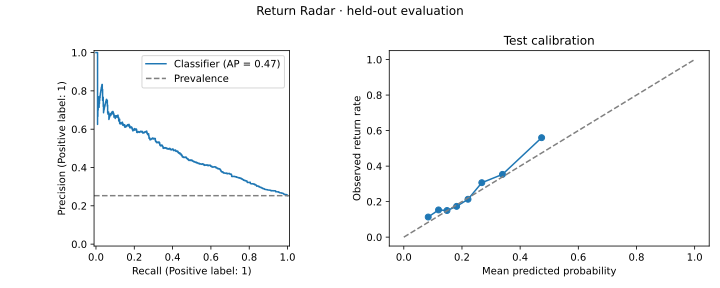

# Return Radar

Predict whether an e-commerce order will be returned within 30 days, using only purchase-time features. A reproducible ML project built with pandas and scikit-learn, with chronological evaluation, label-maturity gaps, an explicit baseline, and exact additive explanations.

**The bundled dataset is synthetic. These measurements are a demo, not evidence of performance on real customers.**

## Run

Python 3.10+:

```bash
python -m venv .venv
. .venv/bin/activate
pip install -r requirements.txt
python -m unittest discover -s tests -v
python radar.py --out work/demo
```

Outputs:

- `report.json`: split dates, metrics, baseline, validation-selected threshold, cost assumptions, and one order explanation.
- `test_predictions.csv`: held-out labels, probabilities, and review flags.
- `evaluation.png` / `evaluation.svg`: precision-recall and calibration plots.



## How evaluation works

1. Generate 12,000 fictional orders spanning 540 days, or read your CSV.
2. Sort by purchase time; use 60% / 20% / 20% chronological boundaries.
3. Purge training labels that are not available strictly before the validation period, and validation labels not available strictly before the test period. A return label matures no earlier than 30 days after purchase.
4. Fit imputation, scaling, one-hot encoding, and logistic regression using **training data only**.
5. Choose a review threshold using **validation data only**, minimizing assumed missed-return / false-alarm cost (8 / 2 cost units). Select a training-rate baseline's threshold using validation too.
6. Evaluate once on the held-out future orders. Report ROC-AUC, average precision, Brier score, precision, recall, confusion counts, and assumed cost. Plot calibration and precision-recall.

The model is not refitted on validation before test evaluation. The test labels never select a threshold or train preprocessing. A test changes the holdout labels and verifies that the predictions and threshold remain unchanged.

## Observed demo results

| Metric | Logistic regression | Training-rate baseline |
| --- | ---: | ---: |
| ROC-AUC | 0.697 | 0.500 |
| Average precision | 0.465 | 0.253 |
| Brier score (lower is better) | 0.170 | 0.189 |
| Assumed cost / order (lower is better) | 1.223 | 1.494 |

Held-out sample: 2,400 orders; return prevalence: 25.29%. Training: 6,534; validation: 1,734; purged: 1,332. See [the complete report](examples/demo-report.json). Numbers can vary slightly across dependency versions.

These costs are illustrative classification penalties. They do **not** measure financial savings or the effect of a real intervention. Flags are for review, not automatic order rejection.

## Your CSV

```bash
python radar.py --csv orders.csv --out work/real-evaluation
```

The file must contain exactly these columns:

| Column | Meaning / rule |
| --- | --- |
| `ordered_at` | Purchase timestamp, interpreted as UTC |
| `price` | Nonnegative purchase price |
| `discount` | Discount fraction between 0 and 1 |
| `quantity` | Quantity, at least 1 |
| `customer_tenure_days` | Nonnegative account age **at purchase** |
| `category` | Product category string |
| `channel` | Purchase channel string |
| `returned` | Observed 30-day return label: 0 or 1 |
| `label_available_at` | Timestamp at which the full label was observable; at least 30 days after purchase |

Missing feature values are imputed using training statistics. Missing dates/labels, invalid ranges, unknown columns, and splits without both classes are rejected. Unknown categories at prediction time are handled by the encoder.

Labels in your file must already have matured at the time you run offline evaluation. The program checks timestamps relative to purchases and split boundaries; it cannot verify when your warehouse actually observed a label. Use only genuinely purchase-time features: an allowlist cannot detect a misleadingly named feature that was calculated later.

Refund amounts, return reasons, delivery outcomes, and later customer activity must never be used as features. Keep personal identifiers out of this dataset.

## Reuse the fitted model

```python
from radar import generate, run, FEATURES

model, report, predictions = run(generate())
orders = generate(500).iloc[:3][FEATURES]  # replace with purchase-time feature rows
probabilities = model.predict_proba(orders)[:, 1]
```

The pipeline is returned to Python callers; the CLI writes evaluation artifacts rather than serializing an executable model file. This is an offline ML project, not a hosted prediction service.

## Explanations and limits

The report includes each transformed feature's exact contribution to log-odds. Their sum plus the intercept reconstructs the predicted probability. Contributions describe the fitted model, not causal reasons for a return.

Customers can recur across time splits, so this evaluates future orders rather than new-customer generalization. No customer-history return rate is used, avoiding a common source of label leakage. Synthetic generation favors the model family used here. Real deployment needs provenance checks, realistic costs, subgroup evaluation, drift monitoring, and prospective validation.

## CI

GitHub Actions installs dependencies, runs the tests, executes the demo, and uploads evaluation artifacts. No external datasets, paid API, or credentials are required. Earlier user-specific test steps were not available; the repository tests document the checks actually performed.
